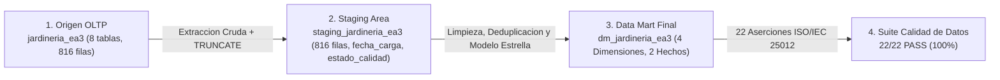

# Proyecto Integrador — Bases de Datos II (Caso Jardinería)

**Evidencia de Aprendizaje 4: Repositorio Integrador y Pruebas de Verificación de Calidad de Datos**

* **Estudiante:** Carlos Alberto Millán Castaño — **Grupo 3**
* **Docente:** Mg. Carolina Márquez
* **Asignatura:** Bases de Datos II (`PREICA2602B020061`)
* **Institución:** Institución Universitaria Digital de Antioquia (IU Digital)
* **Periodo:** 2026_2_B2
* **Repositorio en GitHub:** https://github.com/AlbertoMillanC/EA4_Grupo3_ProyectoIntegrador_Jardineria

---

## Arquitectura Integrada del Proyecto (Origen → Staging → Data Mart → Calidad)



---

## Estructura de Carpetas del Repositorio

```text
EA4_Grupo3_ProyectoIntegrador_Jardineria/
├── 01_EA1_Modelo_Estrella/
│   ├── README.md
│   ├── diagramas/                   # ModeloEstrella_Jardineria.mdj y Modelo_Estrella_Jardineria.jpg
│   └── informe/                     # Informe EA1 (PDF/DOCX) y documento de correcciones
├── 02_EA2_Base_Datos_Staging/
│   ├── README.md
│   ├── backups_bk/                  # Respaldos SQL Server (.bak), MySQL (.sql) y PostgreSQL (.backup/.sql)
│   ├── evidencias/                  # Capturas de ejecución MySQL Workbench y PowerShell
│   ├── informe/                     # EA2_Grupo3_Staging_Jardineria.pdf y .docx
│   └── scripts_sql/                 # Perfilamiento 1 a 1 (63 columnas) + Staging crudo con TRUNCATE
├── 03_EA3_Proceso_ETL_DataMart/
│   ├── README.md
│   ├── backups_bk/                  # Respaldos completos de Origen, Staging y Data Mart EA3
│   ├── evidencias/                  # Capturas reales de consola y MySQL Workbench
│   ├── informe/                     # EA3_Grupo3_ProcesoETL.pdf y .docx
│   └── scripts_sql/                 # Scripts DDL/DML Origen, Staging, Transformación Data Mart y KPIs
├── 04_Pruebas_Calidad_Datos/
│   ├── README.md
│   ├── run_data_quality_tests.py    # Runner automatizado (prueba idempotencia + 22 aserciones SQL)
│   ├── scripts_sql/                 # Scripts SQL por capa: origen, staging y datamart
│   └── reportes/                    # REPORTE_CALIDAD_DATOS.md y resultados_pruebas_calidad.csv (22/22 PASS)
└── 05_EA4_Integracion_Final/
    └── EA4_Grupo3_Integracionfinal.pdf  # Portada APA 7, enlace al repositorio y resumen ejecutivo
```

---

## Resultados Clave Verificados

### 1. Pruebas de Calidad de Datos (`04_Pruebas_Calidad_Datos`)
* **Resultado global:** **22 / 22 pruebas aprobadas (`100 % PASS`, `0` fallos)** bajo las 6 dimensiones de **ISO/IEC 25012** y **DAMA-DMBOK**:
  * **Completitud (`DQ-01`–`DQ-04`):** `0` nulos en llaves subrogadas, códigos, países o métricas.
  * **Unicidad (`DQ-05`–`DQ-08`):** `Lasas S.A.` consolidado (`36 → 35` clientes) y línea duplicada `ID_detalle=317` depurada.
  * **Integridad Referencial (`DQ-09`–`DQ-12`):** `0` registros huérfanos en `fact_ventas` y `fact_pagos`.
  * **Exactitud y Consistencia (`DQ-13`–`DQ-17`):** `0` pedidos `Rechazado` en ventas, `0` descuadres aritméticos, precio histórico preservado.
  * **Validez y Estandarización (`DQ-18`–`DQ-20`):** Países homologados al español, `0` espacios laterales y `0` textos corruptos (`2 para todo...`, `1ª`, `DECÃ`, `Fraçois`).
  * **Conciliación e Idempotencia (`DQ-21`–`DQ-22`):** Re-ejecución de Staging con `TRUNCATE` mantiene `816` filas exactas; `fact_ventas = 253` (`318 − 64 rechazadas − 1 duplicada`) y `fact_pagos = 26`.

### 2. Analítica de Negocio en el Data Mart (`dm_jardineria_ea3`)
* **Producto más vendido (unidades físicas):** `AR-009` (*Thymus Vulgaris*, Aromáticas) con **961 unidades** en 6 pedidos (`$986.00`).
* **Producto líder en ingresos:** `OR-247` (*Trachycarpus Fortunei*, Ornamentales) con **$72,408.00** (identificando margen negativo de `-$654.00` por liquidación histórica a `$8.00` frente a costo `$369.00`).
* **Producto más rentable:** `OR-227` (*Chamaerops Humilis*) con **$3,068.00** de utilidad bruta.

---

## Guía Rápida de Reproducción (MySQL 8.4)

```bash
# 1. Cargar origen adaptado desde el script del curso
mysql -u root --default-character-set=utf8mb4 -e "SOURCE 03_EA3_Proceso_ETL_DataMart/scripts_sql/01_Origen_Jardineria_EA3.sql"

# 2. Extraer hacia Staging crudo (idempotente con TRUNCATE)
mysql -u root --default-character-set=utf8mb4 -e "SOURCE 03_EA3_Proceso_ETL_DataMart/scripts_sql/02_Extraccion_Staging_EA3.sql"

# 3. Transformar y cargar Data Mart Estrella
mysql -u root --default-character-set=utf8mb4 -e "SOURCE 03_EA3_Proceso_ETL_DataMart/scripts_sql/03_Transformacion_Carga_DataMart_EA3.sql"

# 4. Ejecutar suite automatizada de 22 pruebas de calidad de datos
python 04_Pruebas_Calidad_Datos/run_data_quality_tests.py
```
